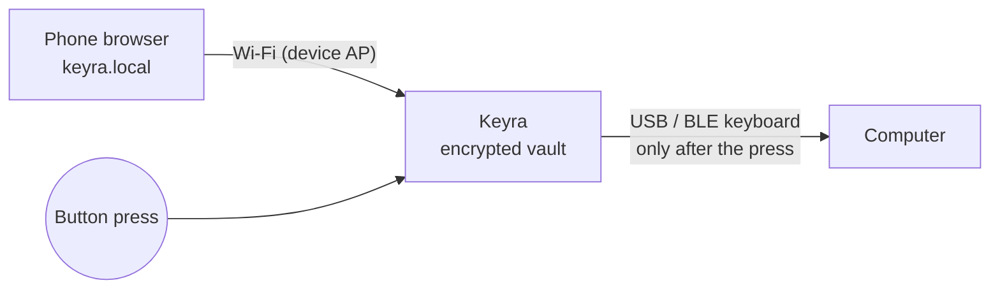

# Design references 2026: brief for the Contour identity

Status: research brief, October 2026. Feeds a later revision of `docs/DESIGN.md` (which still describes "Quiet Glass", blue accent).
Fixed inputs (not up for debate here): the **Contour** mark (one continuous white line drawing a shield, round caps, a
small gap at the top-right, on a near-black graphite rounded square); monochrome luxury (graphite / ink / warm ivory
paper); **blue means one thing only: the device is waiting for your press**; Readex Pro (variable, 400–700 subset,
Arabic + Latin) already embedded; web app first-load budget ~130 KB gzip, no external fonts/CDNs, offline, RTL.

How to read the evidence tags:
- **[measured]** values pulled from the site's shipped CSS on 2026-10-13 (curl + grep of their stylesheets).
- **[stated]** taken from the company's own published writing.
- **[observed]** a visual pattern described from the site, not measured; treat numbers next to it as Keyra's proposal.

---

## 0. What the best work of 2024–2026 has in common (the short version)

1. **Restraint is the luxury signal.** Awwwards Sites of the Year (2024: Igloo Inc, Don't Board Me, *Opal Tadpole*;
   2025: Lando Norris by OFF+BRAND, Messenger by abeto) are WebGL showpieces, so **do not copy their technique**: it breaks
   our budget. The transferable lesson is Opal Tadpole's (a hardware webcam site): one object, huge, on a quiet field,
   with copy that gets out of the way. The product sites people keep citing (Linear, Vercel, Teenage Engineering, Nothing,
   Apple, Leica, B&O, Things) all share: one neutral canvas, very few colours, hairlines instead of boxes, short motion.
2. **Neutrals went warm.** Linear's latest refresh moved its default light and dark palettes "away from a cool, blue-ish
   hue toward a warmer gray", and warned that going too warm "made the interface look muddy" **[stated]**. That is exactly
   the graphite/ivory move Keyra is making; heed the warning (chroma ≤ 0.012 in OKLCH for neutrals).
3. **Colour carries meaning, not decoration.** Nothing runs black/white/grey with a single signal accent; Vercel's
   `design.md` says "default to stillness, add motion only to explain state changes" **[stated]**. Keyra's rule "blue =
   waiting for press" is the same discipline, stricter.
4. **The motion vocabulary converged on two curves**: an ease-out-quint for things appearing
   (`cubic-bezier(.23,1,.32,1)`, Raycast 15×, Linear `--ease-out-quint` **[measured]**) and the iOS-sheet curve for
   things that slide (`cubic-bezier(.32,.72,0,1)`, Linear 7×, Vercel 4× **[measured]**). Durations cluster at
   150–300 ms (Vercel .15s/.2s, Raycast .2s/.3s, Stripe .3s, Apple 240 ms/.4s **[measured]**).

---

## 1. Fourteen patterns worth stealing

Each: source → what they do → how Keyra applies it inside the constraints.

### P1. Level-based warm neutrals instead of "cards on grey"
- **Source:** Linear. Dark backgrounds step in tiny increments: `--color-bg-level-0..3: #08090a #0f1011 #141516 #191a1b`;
  light: `#fff #f8f8f8 #f4f4f4 #f0f0f0` **[measured]**. Each level is ~1.5–2 L* apart; elevation is read from
  lightness, not shadow.
- **Keyra:** four paper levels in light (`--bg #F4F1EA` → `--surface #FBFAF6` → `--surface-2 #ECE8DF` → `--fill #E6E1D6`)
  and four graphite levels in dark (`#0D0E10 → #16171A → #1E1F23 → #26272C`). Sheet = one level up; pressed = one level
  down. No other tinting. Tokens in §2.

### P2. Hairlines as 1 px alpha rings, and fewer of them
- **Source:** Vercel Geist uses `--ds-shadow-border-base: 0 0 0 1px #00000014` (8 % black) and `#ffffff25` in dark
  **[measured]**; Geist's `design.md`: "prefer spacing, alignment, and typography over borders… don't wrap every section
  in a card" **[stated]**. Linear's translucent borders: `#0000000d` / `#ffffff0d` (5 %) **[measured]**; its refresh
  "softened divider contrast and used fewer separators" **[stated]**.
- **Keyra:** `--hair: rgba(22,23,26,.10)` light / `rgba(238,235,228,.09)` dark, applied as
  `box-shadow: 0 0 0 1px var(--hair)` (no layout shift, follows radius, no double borders in grouped lists). Account rows:
  inset separator only between rows, starting after the icon (`margin-inline-start: 56px` so it mirrors in RTL for free).
  Delete card borders where a 16–24 px gap already separates things. `--hair-strong` (≥3:1) only for form-field outlines
  and the focus-adjacent states that WCAG 1.4.11 requires.

### P3. One signal colour, one meaning
- **Source:** Nothing (monochrome system, accent used as a signal, never as chrome) **[observed]**; Vercel "stillness by
  default" **[stated]**.
- **Keyra:** primary buttons are **ink on paper** (dark fill, ivory label), not blue. Links are ink + underline
  (`text-decoration-thickness:1px; text-underline-offset:.2em`). Blue (`--signal`) is allowed in exactly three places,
  all tied to the device waiting: the Contour gap while pending, the Ready-state ring, and the "Waiting for press" chip.
  Focus rings become ink (`--focus: var(--ink)` with a 2 px paper gap), so blue never appears on idle screens.
  Lint rule worth adding later: grep the CSS for `var(--signal)` outside `ready*`/`contour*` selectors.

### P4. Spec-sheet labels (label/value rows, tabular figures)
- **Source:** Teenage Engineering product pages list specs as plain label/value lines grouped by heading, lowercase voice
  **[observed]**; TE ships its own thin faces `te-20`/`te-40` at weights 100/300 **[measured]**. Nothing uses LL Lettera
  Mono uppercase ~11 px for every label, nav link and button **[observed, third-party analyses]**.
- **Keyra:** the Device / About / Diagnostics screens become a spec sheet: two-column grid, label `--ink-3` 13 px 500,
  value `--ink` 15 px 400 `font-variant-numeric: tabular-nums`, hairline between groups only.
  ```css
  .spec{display:grid;grid-template-columns:minmax(8rem,40%) 1fr;column-gap:16px;row-gap:10px}
  .spec dt{color:var(--ink-3);font-size:var(--fs-label);font-weight:500}
  .spec dd{margin:0;font-variant-numeric:tabular-nums;unicode-bidi:plaintext} /* MACs/IPs stay LTR inside RTL */
  ```
  Latin labels may use `text-transform:uppercase; letter-spacing:.06em; font-size:11px`. **Arabic has no case**: under
  `:lang(ar)` drop the transform and tracking and use weight 500 at 12.75 px instead; never fake small caps in Arabic.

### P5. Tight display tracking for Latin, zero tracking for Arabic
- **Source:** Apple: `letter-spacing:-0.022em` on 17 px+ text and `+.011em` at 12 px **[measured]**; Linear `title-4`
  2rem / 1.125 / -.022em, body `.9375rem / 1.6 / -.011em` **[measured]**; Vercel −0.96 px and −1.28 px on display
  sizes **[measured]**.
- **Keyra:** tracking token per step for Latin (§2.4). For Arabic set `letter-spacing:0` on every step: tracking
  breaks the joined script's rhythm (Chrome/Safari insert gaps between connected letters). Readex Pro's Arabic is
  designed on the same metrics as its Latin, so keep the existing 106.25 % Arabic root and looser leading.

### P6. A two-curve motion vocabulary with short durations
- **Source:** Raycast `cubic-bezier(.23,1,.32,1)` and `(.16,1,.3,1)`, transitions mostly .2s/.3s; Linear
  `cubic-bezier(.32,.72,0,1)`, 160 ms; Vercel `.15s`/`.2s` plus `(.32,.72,0,1)`; Apple `(.4,0,.6,1)` (234 uses) and
  `(0,0,.2,1)`, 240 ms; Stripe `(.25,1,.5,1)` .3s **[all measured]**.
- **Keyra:** collapse the current four eases to three named intents (§2.6): `--ease-enter (.23,1,.32,1)`,
  `--ease-slide (.32,.72,0,1)`, `--ease-state (.4,0,.6,1)`. Keep the existing `linear()` spring only for the success
  moment. Exits are 70 % of the enter duration.

### P7. The object is the hero
- **Source:** Opal Tadpole (Awwwards SOTY 2024), Teenage Engineering, Leica, Bang & Olufsen: one product, generous
  negative space, little copy, photography on a neutral field **[observed]**. Ledger/Yubico explain trust through the
  physical act (secure element, "touch-to-sign") **[stated on their pages]**.
- **Keyra:** the Ready state is the stage. Replace the generic ring+key glyph with the **Contour mark at 120 px** inside
  the 176 px countdown ring; nothing else on the card except title, the "what · account" chip, countdown and Cancel.
  README hero = a real photo of the stick on ivory paper (light) / on graphite (dark), lit from top-left, LED blue.

### P8. Grain as a material, used once
- **Source:** Linear overlays a noise tile: `background-size:256px 256px; mix-blend-mode:overlay; opacity:.9` plus an
  `:after` wash of `#ffffff0f` **[measured]**.
- **Keyra:** an inline SVG `feTurbulence` data-URI (~350 B, no image file) only on the static lock/welcome screen and the
  app icon tile; never on scrolling lists (blend modes repaint on scroll on low-end Android).
  ```css
  .paper::before{content:"";position:fixed;inset:0;pointer-events:none;opacity:.045;
    background:url("data:image/svg+xml,%3Csvg xmlns='http://www.w3.org/2000/svg' width='160' height='160'%3E%3Cfilter id='n'%3E%3CfeTurbulence type='fractalNoise' baseFrequency='.9' numOctaves='2' stitchTiles='stitch'/%3E%3C/filter%3E%3Crect width='100%25' height='100%25' filter='url(%23n)'/%3E%3C/svg%3E")}
  @media (prefers-reduced-transparency:reduce),(prefers-contrast:more){.paper::before{display:none}}
  ```

### P9. Glass only where content scrolls beneath
- **Source:** Raycast's dark surfaces are white alphas `#ffffff0d` (5 %) and `#ffffff1a` (10 %) **[measured]**; Apple
  uses blur only on sticky nav **[observed]**.
- **Keyra:** keep `backdrop-filter` for the sticky top bar and the bottom sheet's header only. Every other card is a
  solid level from P1. This also cuts GPU cost on the phone the vault is managed from.

### P10. Physical confirmation told as one sentence plus one light
- **Source:** Ledger frames trust as "approve on the device" and the secure element; YubiKey as touch-to-sign with no
  battery **[stated]**. Both keep the explanation to a single act.
- **Keyra:** every presence screen uses the same three-line structure: verb title ("Press Keyra's button"), what will
  happen ("Types the password for GitHub"), the countdown. The on-screen blue breath is phase-matched to the LED
  (1600 ms, firmware `Led::Pending`) so the phone and the stick visibly pulse together. That synchrony *is* the brand.

### P11. Iconography drawn with the logo's pen
- **Source:** Linear's refresh: smaller icons, fewer of them, no coloured icon backgrounds **[stated]**.
- **Keyra:** all UI icons on a 24 px grid, `stroke-width:1.75`, `stroke-linecap:round`, `stroke-linejoin:round`,
  `fill:none`, colour `currentColor` (= ink-2 at rest, ink when active). Same caps as Contour, so the mark reads as the
  family's parent. Drop filled/coloured site-favicon tiles in rows to a 32 px paper-level square with a 1 px hair ring
  and a single initial in ink-2 (monogram) when no favicon is cached.

### P12. Dimmed chrome, bright content
- **Source:** Linear dimmed the sidebar "a few notches so the main content takes precedence", muted inactive text
  **[stated]**.
- **Keyra:** bottom tab bar inactive = `--ink-3`, active = `--ink` + 600; no pill, no tint. Section headers in lists
  = `--ink-3` 13 px 500. The only full-ink text on the vault list is the account title.

### P13. Numbers as display type
- **Source:** Nothing's dot-matrix face reserved for product names/numbers; TE's numeric spec blocks **[observed]**.
- **Keyra:** don't ship a second font (budget). Instead: TOTP codes and the countdown in Readex Pro 500,
  `font-variant-numeric: tabular-nums`, `letter-spacing:.04em`, split into groups of 3 with a 0.35 em gap, size
  `--fs-display`. Always `direction:ltr; unicode-bidi:isolate` so codes never flip in Arabic.

### P14. README as a product page with a shelf of proof
- **Sources:** Excalidraw (`<picture>` with a `prefers-color-scheme: dark` source for the cover), Bun (centred link row
  separated by `&nbsp;&nbsp;•&nbsp;&nbsp;`), Tauri (platform/version table), Immich (GitHub alerts `> [!WARNING]`,
  a language-links row, a features table with Mobile/Web columns), Lazygit (one short `<video>` per feature hosted as a
  GitHub user-attachment), Ghostty/shadcn (very short READMEs that link out), Supabase (architecture diagram + client
  table) **[all read from their README sources]**.
- **Keyra:** §4.

---

## 2. Token set: "Ink & Paper" (light) / "Graphite" (dark)

All ratios computed with the WCAG 2.x relative-luminance formula (script run on 2026-10-13). AA: text ≥ 4.5:1,
large text and UI parts ≥ 3:1.

### 2.1 Light: Ink & Paper

| Token | Value | Use | Ratio vs bg / surface / surface-2 |
|---|---|---|---|
| `--bg` | `#F4F1EA` | warm ivory paper | – |
| `--surface` | `#FBFAF6` | sheets, raised | – |
| `--surface-2` | `#ECE8DF` | grouped list, Ready card | – |
| `--fill` | `#E6E1D6` | inputs, pressed | – |
| `--ink` | `#16171A` | titles, primary text, primary button fill | 15.89 / 17.16 / 14.66 |
| `--ink-2` | `#4A4A50` | body secondary | 7.80 / 8.43 / 7.20 (6.75 on fill) |
| `--ink-3` | `#5E5D63` | labels, captions, inactive tabs | 5.78 / 6.24 / 5.33 (5.00 on fill) |
| `--hair` | `rgba(22,23,26,.10)` | separators (decorative, exempt) | – |
| `--hair-strong` | `#7F7C75` | input outlines, toggles off | 3.69 / 3.99 / 3.41 |
| `--signal` | `#1D4ED8` | waiting-for-press ONLY | 5.94 / 6.42 / 5.48 |
| `--signal-soft` | `#E4EAFB` | waiting chip bg | signal on it 5.57 |
| `--ok` | `#1C7543` | typed / success | 5.07 / 5.47 / 4.67 |
| `--ok-soft` | `#E2EFE6` | | ok on it 4.82 |
| `--err` | `#B3261E` | errors, destructive text | 5.79 / 6.26 / 5.35 |
| `--err-soft` | `#F7E3E0` | | err on it 5.30 |
| `--on-ink` | `#F4F1EA` | label on ink button | 15.89 |
| `--led` | `#2F6BFF` | LED illustration only (photo/diagram), never text | 3.99 (graphic only) |

### 2.2 Dark: Graphite

| Token | Value | Use | Ratio vs bg / surface / surface-2 |
|---|---|---|---|
| `--bg` | `#0D0E10` | graphite | – |
| `--surface` | `#16171A` | sheets (same as the logo tile) | – |
| `--surface-2` | `#1E1F23` | grouped list, Ready card | – |
| `--fill` | `#26272C` | inputs, pressed | – |
| `--ink` | `#EEEBE4` | warm ivory ink | 16.22 / 15.06 / 13.83 |
| `--ink-2` | `#B6B2AA` | | 9.14 / 8.48 / 7.79 (7.05 on fill) |
| `--ink-3` | `#9A978F` | | 6.62 / 6.14 / 5.64 (5.11 on fill) |
| `--hair` | `rgba(238,235,228,.09)` | separators | – |
| `--hair-strong` | `#6E6C66` | input outlines | 3.68 / 3.41 / 3.14 |
| `--signal` | `#7AA2FF` | waiting-for-press ONLY | 7.76 / 7.20 / 6.62 |
| `--signal-soft` | `#182238` | | signal on it 6.37 |
| `--ok` | `#5CCB8C` | | 9.54 / 8.86 / 8.14 |
| `--ok-soft` | `#12271B` | | ok on it 7.79 |
| `--err` | `#FF8E80` | | 8.67 / 8.05 / 7.40 |
| `--err-soft` | `#33191A` | | err on it 7.29 |
| `--on-ink` | `#0D0E10` | label on ivory button | 16.22 |

Notes: in dark the primary button **inverts** to an ivory fill with graphite label (the Apple/Linear move); the logo
tile `#141518` vs dark bg is 1.06:1, so in dark mode the app icon/mark tile gets the `--hair` ring (P2), and in
light it sits at 16.2:1 with no ring. Warn (amber) is dropped: use `--err` for blocking problems and ink for notices;
one fewer hue keeps the palette monochrome. If a warn tone is unavoidable (TOTP < 10 s), use `--ink` + weight change,
not a colour.

### 2.3 Paste-ready CSS (replaces the colour block of `web/src/styles/tokens.css`; keep the media+attribute duplication)

```css
:root{
  --bg:#F4F1EA;--surface:#FBFAF6;--surface-2:#ECE8DF;--fill:#E6E1D6;--fill-press:#DDD7CB;
  --ink:#16171A;--ink-2:#4A4A50;--ink-3:#5E5D63;--on-ink:#F4F1EA;
  --hair:rgba(22,23,26,.10);--hair-strong:#7F7C75;
  --signal:#1D4ED8;--signal-soft:#E4EAFB;--signal-glow:rgba(29,78,216,.16);
  --ok:#1C7543;--ok-soft:#E2EFE6;--err:#B3261E;--err-soft:#F7E3E0;
  --focus:var(--ink);--scrim:rgba(13,14,16,.36);
  --sh-1:0 0 0 1px var(--hair);
  --sh-2:0 0 0 1px var(--hair),0 6px 18px -6px rgba(22,23,26,.10);
  --sh-3:0 0 0 1px var(--hair),0 -12px 40px -8px rgba(22,23,26,.16);
  color-scheme:light;
}
@media (prefers-color-scheme:dark){:root:not([data-theme="light"]){
  --bg:#0D0E10;--surface:#16171A;--surface-2:#1E1F23;--fill:#26272C;--fill-press:#2E2F35;
  --ink:#EEEBE4;--ink-2:#B6B2AA;--ink-3:#9A978F;--on-ink:#0D0E10;
  --hair:rgba(238,235,228,.09);--hair-strong:#6E6C66;
  --signal:#7AA2FF;--signal-soft:#182238;--signal-glow:rgba(122,162,255,.18);
  --ok:#5CCB8C;--ok-soft:#12271B;--err:#FF8E80;--err-soft:#33191A;
  --scrim:rgba(0,0,0,.6);
  --sh-1:0 0 0 1px var(--hair);
  --sh-2:0 0 0 1px var(--hair),0 8px 24px -6px rgba(0,0,0,.55);
  --sh-3:0 0 0 1px rgba(238,235,228,.12),0 -16px 48px -8px rgba(0,0,0,.7);
  color-scheme:dark;
}}
/* :root[data-theme="dark"]{ …identical copy… } */
@media (prefers-contrast:more){:root{--hair:var(--hair-strong);--ink-3:var(--ink-2)}}
```
Shadows: dark mode relies on the hair ring, not on shadow (shadows are invisible on graphite; Linear sets
`--shadow-low: none` in some themes **[measured]**).

### 2.4 Type scale (Readex Pro, variable 400–700)

Latin root 16 px; Arabic root 17 px (existing 106.25 %), so every rem grows 6 %. Arabic needs taller line-height
(ascenders/descenders and dots) and **zero tracking**.

| Step | Size (rem) | Weight | Latin lh / tracking | Arabic lh / tracking | Use |
|---|---|---|---|---|---|
| `display` | 2.25 | 500 | 1.08 / −0.022em | 1.35 / 0 | TOTP, lock title, Ready countdown |
| `t1` | 1.75 | 500 | 1.15 / −0.02em | 1.4 / 0 | screen titles |
| `t2` | 1.375 | 600 | 1.25 / −0.015em | 1.5 / 0 | sheet / card titles |
| `headline` | 1.0625 | 600 | 1.35 / −0.011em | 1.6 / 0 | row titles |
| `body` | 1 | 400 | 1.5 / −0.006em | 1.7 / 0 | text |
| `callout` | .9375 | 400 | 1.45 / −0.004em | 1.65 / 0 | secondary text |
| `label` | .8125 | 500 | 1.35 / 0 | 1.6 / 0 | spec labels, section heads |
| `micro` | .6875 | 500 | 1.3 / +.06em UPPER | (use `label`) | Latin-only eyebrow |

Weights: 500 for display (luxury reads lighter and larger; we cannot go below 400 in the subset), 600 for UI titles,
400 body. Never 700 except numerals in the success state. Mixed Arabic/Latin strings (account names): `unicode-bidi:plaintext` on the title element.

### 2.5 Radii, spacing

- Radii: `--r-xs 6`, `--r-sm 10`, `--r-md 14`, `--r-lg 20`, `--r-xl 28`, `--r-pill 999`. Rule: nested radius =
  outer − padding (card 28 / padding 16 → inner 12). The Contour tile uses a 22.5 % radius
  (`rx="22.5"` on a 100 box, as in `favicon.svg`), close to the iOS/Android icon masks.
- Spacing unchanged (4-pt). Prefer 24 px between groups over separators (P2).

### 2.6 Motion

```css
:root{
  --d-1:120ms;  /* press feedback, colour flips */
  --d-2:200ms;  /* small enters (chip, toast) */
  --d-3:320ms;  /* sheet, card collapse */
  --d-4:480ms;  /* page-level, ring snap */
  --d-draw:900ms; /* Contour draw-in, once per session */
  --d-breath:1600ms; /* = firmware Led::Pending period; never change one without the other */
  --ease-enter:cubic-bezier(.23,1,.32,1);  /* ease-out-quint: Raycast, Linear */
  --ease-slide:cubic-bezier(.32,.72,0,1);  /* sheet/drawer: Linear, Vercel */
  --ease-state:cubic-bezier(.4,0,.6,1);    /* symmetric: Apple; breathing, colour */
  --ease-exit:cubic-bezier(.4,0,1,1);
}
@media (prefers-reduced-motion:reduce){:root{--d-1:0ms;--d-2:0ms;--d-3:0ms;--d-4:0ms;--d-draw:0ms}}
```
Rules: one property group animates per interaction (transform+opacity, or stroke, never layout); exit = 0.7× enter;
nothing loops except the waiting breath; under reduced motion the breath becomes a static blue gap (state still
legible without motion, which also satisfies WCAG 2.3.3).

---

## 3. Signature motion around the Contour line

### 3.1 The mark as SVG (one path + one gap segment)

Geometry taken from the shipped `web/public/favicon.svg` (tile `#141518`, `rx 22.5`, 12 % white inner ring, stroke
`#F2F2EF` 8.5, round caps/joins, group scaled 1.12). The line starts just right of the gap, runs down the right side to
the point, up the left side, over the apex, and stops on the top-right slope; the missing piece of that slope is the gap.
The gap path is that missing piece, painted **under** the line so the white round caps overlap it cleanly.
```html
<svg class="contour" viewBox="0 0 100 100" role="img" aria-label="Keyra">
  <rect class="tile" width="100" height="100" rx="22.5"/>
  <rect x="1" y="1" width="98" height="98" rx="21.5" fill="none" stroke="#fff" stroke-opacity=".12" stroke-width="2"/>
  <g transform="translate(50 50) scale(1.12) translate(-50 -50)">
    <path class="gap"  pathLength="100" d="M61.5 25.86L74 32.24"/>
    <path class="line" pathLength="100" d="M74 32.24L75.5 33V44C75.5 60 64 73 50 80C36 73 24.5 60 24.5 44V33L50 20L61.5 25.86"/>
  </g>
</svg>
```
```css
/* The tile is graphite in both themes, so the mark always uses the dark-theme signal/ok values
   (#7AA2FF 7.34:1 and #5CCB8C 9.02:1 on #141518; light-theme #1D4ED8 would be only 2.72:1). */
.contour{--m-signal:#7AA2FF;--m-ok:#5CCB8C;--m-ink:#F2F2EF}
.contour .tile{fill:#141518}
.contour .line,.contour .gap{fill:none;stroke:var(--m-ink);stroke-width:8.5;stroke-linecap:round;stroke-linejoin:round}
.contour .gap{opacity:0} /* idle: the gap is open */
```
`pathLength="100"` normalises dash maths so no JS measuring is needed (SVG 2; all evergreen engines).
The mark is **never mirrored in RTL** (it is a logo, like the countdown ring which is a clock): keep it outside any
`transform: scaleX(var(--dir))` rule. The gap is short (~14 units, ~5.5 visible between caps), so states are carried
by colour/opacity of the whole segment, not by dashes inside it.

### 3.2 Draw-in (first paint of Welcome/Unlock, once per session)

```css
.contour.is-drawing .line{stroke-dasharray:100;stroke-dashoffset:100;
  animation:contour-draw var(--d-draw) var(--ease-enter) 120ms forwards}
.contour.is-drawing .tile{animation:tile-in var(--d-3) var(--ease-enter) both}
@keyframes contour-draw{to{stroke-dashoffset:0}}
@keyframes tile-in{from{opacity:0;transform:scale(.96)}}
.contour .tile{transform-box:fill-box;transform-origin:center}
```
The line draws from the gap's right end, down and around, and arrives back at the gap's left end, so the very first
motion already tells the story "the shield stops short of closing". Gate with `sessionStorage` (try/catch) so it plays
once; under reduced motion `--d-draw:0ms` makes it a no-op.

### 3.3 Waiting for the press: the gap fills with breathing blue (the only blue in the product)

The gap segment lights in signal blue and breathes at the LED's 1600 ms period; the ivory line stays still. Read: "the
shield is open where your press goes." Opacity only, so it stays on the compositor.
```css
.contour.is-waiting .gap{stroke:var(--m-signal);animation:gap-breathe var(--d-breath) var(--ease-state) infinite}
@keyframes gap-breathe{0%,100%{opacity:.18}50%{opacity:1}}
@media (prefers-reduced-motion:reduce){.contour.is-waiting .gap{animation:none;opacity:1}}
```
Optional halo for the large (120 px) Ready-card mark only: a second copy of the gap path with `stroke-width:20`,
`opacity` ×0.25 in the same keyframes, so the light seems to leak out of the gap. Skip it at icon sizes.
Set the class when the poll reports `pending`, matching the halo rule in DESIGN §4.11; exact LED phase lock is not
required.

### 3.4 Success: the line closes the gap

```css
.contour.is-done .gap{stroke:var(--m-ok);opacity:1;stroke-dasharray:100;stroke-dashoffset:100;
  animation:gap-close 300ms var(--ease-enter) forwards}
.contour.is-done .line{animation:line-to-ok 160ms var(--ease-state) forwards}
.contour.is-done{animation:seal var(--d-4) var(--ease-spring) 280ms}
@keyframes gap-close{to{stroke-dashoffset:0}}
@keyframes line-to-ok{to{stroke:var(--m-ok)}}
@keyframes seal{50%{transform:scale(1.04)}}
@media (prefers-reduced-motion:reduce){
  .contour.is-done .gap,.contour.is-done .line{animation:none;stroke:var(--m-ok);stroke-dashoffset:0;opacity:1}
  .contour.is-done{animation:none}
}
```
Timeline (fits the existing 1.9 s "Typed" dwell): 0 ms blue gap → ok; 0–300 ms the gap draws shut left-to-right
along the slope; 0–160 ms the line turns ok; 280–760 ms one 4 % "seal" pulse; hold to 1900 ms; then the card collapses
(`--d-3`, `--ease-slide`) and the mark returns to ivory with the gap open: the **idle state is always open**, which is
honest (the device is not doing anything).

### 3.5 Failure / timeout / cancel

- **Expired/cancelled:** the blue gap fades out (`opacity` → 0, 200 ms, `--ease-exit`); the line does not move.
  No red on the mark; the error card below carries the message (P3: colour has one job each).
- **Error (no USB, unsupported char):** the line does a single 2 px horizontal shake (`translateX`, 3 × 60 ms) in
  `--err`, then returns to white. Mirror nothing.

### 3.6 Small uses of the same idea
- **Unlock button pressed:** the line draws (3.2) inside the button-sized mark at 24 px while the KDF runs, looping
  dashoffset 100→0 at 1200 ms linear; it is the spinner, so the app has no second loading glyph.
- **Lock (vault locked):** reverse draw (dashoffset 0→100, 320 ms `--ease-exit`) before the lock screen appears.
- **Favicon/PWA icon:** static mark, gap open. Do not animate favicons.

---

## 4. README: structure and snippets that work on GitHub

GitHub strips `<style>`, `<script>`, inline `style=""` and most attributes; it keeps `align`, `width`, `height`, `alt`,
`<picture>/<source media>`, `<details>/<summary>`, `<kbd>`, `<sub>/<sup>`, tables, `<video>` from user-attachments,
GitHub alerts and ```` ```mermaid ````. SVGs embedded through `` keep their internal CSS `@keyframes`, so an
animated header is possible; they cannot load external fonts and inside `` the SVG's own `prefers-color-scheme`
follows the **OS**, not the GitHub theme toggle, so ship two files and switch them with `<picture>` (GitHub's
documented method; Excalidraw does this). Test the final SVG on a real GitHub page: animation playback is reported
inconsistently, so every animated SVG's final frame must be a complete, static image (animate *to* the resting
state, use `animation-fill-mode: both` and keep the resting values as the base CSS).

### 4.1 Recommended order

1. Theme-aware animated banner (mark + wordmark + one line). 2. One-sentence promise + centred link row.
3. Monochrome badges (max 4). 4. Hero photo (`<picture>`, light/dark). 5. "Why Keyra" (5 bullets, keep current copy).
6. "How it works": 4 numbered steps + 6 s press video. 7. Security model table (protects / does not protect)
+ Mermaid trust-boundary diagram. 8. Quick start (`> [!IMPORTANT]` for flashing). 9. Hardware table (board, price,
button, LED) with a parts photo. 10. Platform/host table (Tauri-style). 11. Screens (light/dark mosaic in `<picture>`).
12. FAQ in `<details>`. 13. Contributing / License. Arabic stays in `README.ar.md` with a row link at top
(Immich pattern), plus a short Arabic paragraph as today.

### 4.2 Header

```html
<div align="center">
  <a href="#readme">
    <picture>
      <source media="(prefers-color-scheme: dark)" srcset="docs/brand/readme-banner-dark.svg">
      
    </picture>
  </a>

  <p><strong>Your passwords stay on the device. Keyra types them only when you press its button.</strong></p>

  <a href="#how-it-works">How it works</a>&nbsp;&nbsp;·&nbsp;&nbsp;<a href="#quick-start">Quick start</a>&nbsp;&nbsp;·&nbsp;&nbsp;<a href="#security-model">Security</a>&nbsp;&nbsp;·&nbsp;&nbsp;<a href="docs/HARDWARE.md">Hardware</a>&nbsp;&nbsp;·&nbsp;&nbsp;<a href="README.ar.md">العربية</a>
  <br><br>

  <a href="https://github.com/hasanalaaa/keyra/actions/workflows/ci.yml"></a>
  
  
  
</div>
```
Badges: today's README uses blue (`0B57F0`, `2F6BFF`) and red (`E7352C`) badges, which spends the signal colour on
decoration. Graphite badges fix that.

### 4.3 Banner SVG (`docs/brand/readme-banner-light.svg`, 1280×360; dark twin swaps the two neutrals)

```svg
<svg xmlns="http://www.w3.org/2000/svg" viewBox="0 0 1280 360" width="1280" height="360" role="img" aria-label="Keyra">
  <style>
    .bg{fill:#F4F1EA} .ink{fill:#16171A} .tile{fill:#141518}
    .l{fill:none;stroke:#F2F2EF;stroke-width:8.5;stroke-linecap:round;stroke-linejoin:round}
    .draw{stroke-dasharray:100;stroke-dashoffset:0;animation:d 1.1s cubic-bezier(.23,1,.32,1) .2s both}
    .gap{stroke:#7AA2FF;animation:b 1.6s cubic-bezier(.4,0,.6,1) 1.4s 3 both}
    .word{font:500 88px system-ui,-apple-system,"Segoe UI",sans-serif;letter-spacing:-2px}
    @keyframes d{from{stroke-dashoffset:100}to{stroke-dashoffset:0}}
    @keyframes b{0%,100%{opacity:0}50%{opacity:1}}
    @media (prefers-reduced-motion:reduce){*{animation:none!important}}
  </style>
  <rect class="bg" width="1280" height="360"/>
  <g transform="translate(425 110) scale(1.4)">
    <rect class="tile" width="100" height="100" rx="22.5"/>
    <g transform="translate(50 50) scale(1.12) translate(-50 -50)">
      <path class="l gap" d="M61.5 25.86L74 32.24" opacity="0"/>
      <path class="l draw" pathLength="100" d="M74 32.24L75.5 33V44C75.5 60 64 73 50 80C36 73 24.5 60 24.5 44V33L50 20L61.5 25.86"/>
    </g>
  </g>
  <text class="ink word" x="605" y="212">Keyra</text>
</svg>
```
- Text in a README SVG renders with the viewer's system font (no webfonts through camo); for brand-exact type,
  **convert the wordmark to outlines** in the final file and delete the `<text>`.
- The gap breathes **3 times then stops** (`3 both`): a README that blinks forever is noise; ending at opacity 0 leaves
  the honest idle mark (gap open).
- Keep each SVG < 15 KB, run SVGO with `removeUnknownsAndDefaults:false` and `cleanupIds:false` so the classes and
  `pathLength` survive.

### 4.4 Body snippets

Hero photo:
```html
<picture>
  <source media="(prefers-color-scheme: dark)" srcset="docs/images/hero-dark.jpg">
  
</picture>
```
Press video (drag the mp4 into a GitHub issue/PR comment to get a `user-attachments` URL; Lazygit embeds these as
`<video src="…" controls></video>`, and a bare URL on its own line also renders a player):
```markdown
https://github.com/user-attachments/assets/<id>
```
Security model as a two-column table:
```markdown
| Keyra protects against | Keyra does not protect against |
|---|---|
| Malware reading a vault on the computer: there is none | Malware reading what Keyra types into the focused field |
| Remote "type now" triggers: every action needs a press | Someone who has the stick **and** your passphrase |
| Phishing the vault file from the cloud: there is no cloud | A computer whose keyboard input is logged in hardware |
```
Trust boundary in Mermaid (renders natively; theme follows GitHub):

Callouts:
```markdown
> [!IMPORTANT]
> Keyra types into whatever field has focus. Click the login field first, then press the button.
```
FAQ:
```html
<details>
<summary><b>Why does my phone say the Wi-Fi has no internet?</b></summary>

Keyra's network is local only, by design. Stay connected and open <code>http://keyra.local</code>.
</details>
```
Hardware/platform table (Tauri-style, keep it short):
```markdown
| Host | USB keyboard | Bluetooth keyboard | Extension |
|---|:-:|:-:|:-:|
| Windows / macOS / Linux | ✓ | ✓ | Chrome, Firefox |
| Android / iPadOS | ✓ (USB-C/OTG) | ✓ | – |
| TV, console, kiosk | ✓ | depends | – |
```
Use `<kbd>Press</kbd>`-style keys sparingly in steps ("hold the button <kbd>1.5 s</kbd> to cancel").
Arabic README: wrap the body in `<div dir="rtl">…</div>` (GitHub's sanitizer keeps `dir`; verify once on the live
page) and keep code blocks and tables outside it or they flip column order.

### 4.5 Assets worth making

| Asset | Size | Format | Notes |
|---|---|---|---|
| README banner light + dark | 1280×360 | SVG ≤ 15 KB each | §4.3; wordmark outlined |
| Hero photo light + dark | 2400×1350 (shown at 100 % width) | JPEG q80 ≤ 350 KB | stick on ivory paper / graphite slate, soft top-left key light, LED blue |
| Press loop video | 1280×720, 6–8 s, no audio | MP4 H.264 ≤ 4 MB | phone taps "Password", hand presses stick, text appears in a login field; one take, no cuts |
| How-it-works strip | 1280×420 | SVG (light/dark pair) | 4 line drawings in the Contour stroke style; replaces `how-it-works.png` |
| LED states strip | 1280×200 | SVG | idle (off), waiting (blue breathe, animated), typed (green), error (red), pairing (cyan); labels below, a legend that matches DESIGN §4.11.1 |
| App screens mosaic light + dark | 1600×1000 | PNG ≤ 400 KB | 3 phones: Vault list, Ready (gap blue), Typed; no device-frame chrome, 28 px corner radius, 1 px hair ring |
| Social preview (repo Settings) | 1280×640 | PNG ≤ 1 MB | graphite, centred mark + wordmark, one line; GitHub's recommended size |
| App icon master | 1024×1024 | SVG + PNG | full-bleed graphite, mark at 62 % width, no pre-rounded corners (OS masks) |
| Favicon | 32 and SVG | SVG ≤ 1 KB | static mark, gap open; dark-mode variant via `prefers-color-scheme` inside the favicon SVG is fine here (browser tab, not GitHub) |
| Parts flat-lay | 2000×1250 | JPEG | board, button, LED ring, case on paper, overhead, labels in the README table, not in the photo |

---

## 5. Applying it inside the 130 KB budget: checklist

- No new font, no images in first load: the mark, grain and icons are inline SVG/CSS (all < 2 KB together).
- Delete, don't add: the blue `--accent*`, `--pw-digit`, `--glow`, `--sh-glow`, warn tokens and most glass tokens go;
  `--signal*` and `--ok/--err` remain. Net CSS should shrink.
- RTL: use logical properties only (`margin-inline-start`, `inset-inline-end`); the mark and countdown ring are exempt
  from mirroring; codes/IPs isolated LTR (P4, P13).
- Reduced motion: every keyframe in §3 has a static end state; the waiting state stays legible as a static blue gap.
- Verify with the existing contrast table in DESIGN §2.1 after the swap (`prefers-contrast:more` maps hairlines to
  `--hair-strong`).
- Keep the firmware/UI period contract: `--d-breath` = `Led::Pending` = 1600 ms.

## Sources

- Awwwards Sites of the Year: https://www.awwwards.com/websites/sites_of_the_year/
- Linear, design refresh: https://linear.app/now/behind-the-latest-design-refresh ; 2024 redesign (LCH themes):
  https://linear.app/now/how-we-redesigned-the-linear-ui ; CSS: static.linear.app `_next/static/css/*` (measured)
- Vercel Geist `design.md`: https://vercel.com/design.md ; CSS from https://vercel.com (measured)
- Raycast https://www.raycast.com, Stripe https://stripe.com, Apple https://www.apple.com/airpods-pro/,
  Teenage Engineering https://teenage.engineering (CSS measured)
- Nothing type system (third-party analyses): https://www.shadcn.io/design/nothing ,
  https://www.fontsinuse.com/uses/59510/nothing-phone
- Ledger https://www.ledger.com/ledger-flex , Yubico https://www.yubico.com/products/yubikey-5-overview/
- READMEs: excalidraw/excalidraw, oven-sh/bun, tauri-apps/tauri, immich-app/immich, jesseduffield/lazygit,
  supabase/supabase, ghostty-org/ghostty, zed-industries/zed, shadcn-ui/ui (raw README.md on GitHub)
- GitHub light/dark images: https://docs.github.com/en/get-started/writing-on-github (picture + prefers-color-scheme)
- Animated SVG in READMEs: https://blog.scalar.com/p/how-we-created-an-animated-responsive
