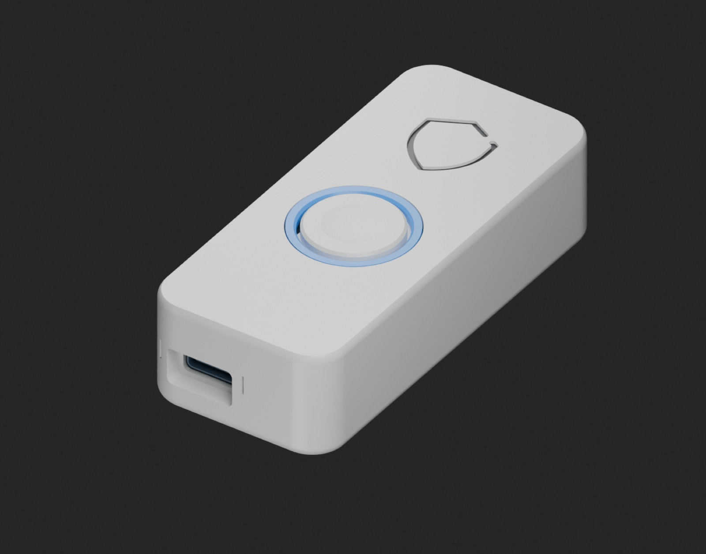
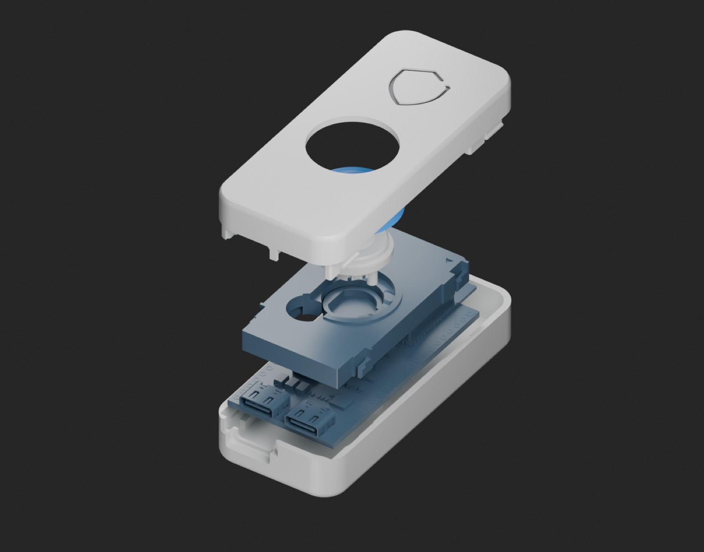
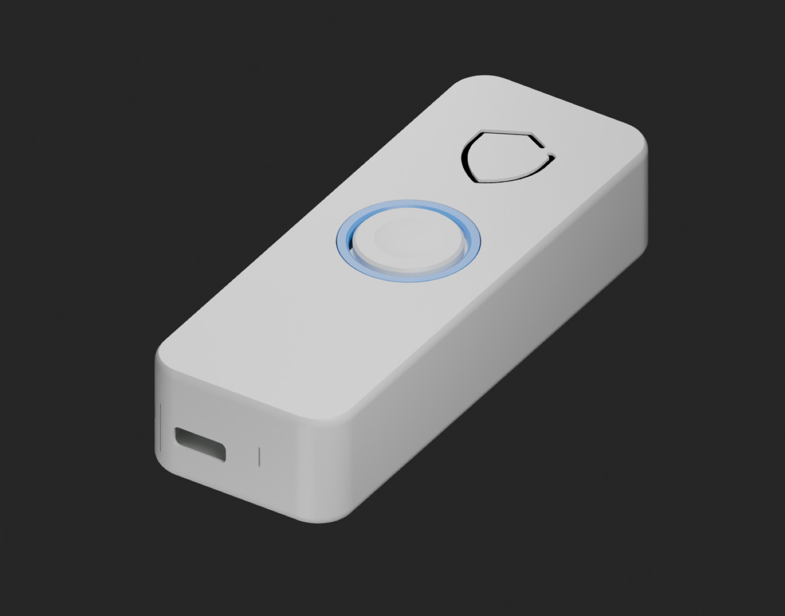
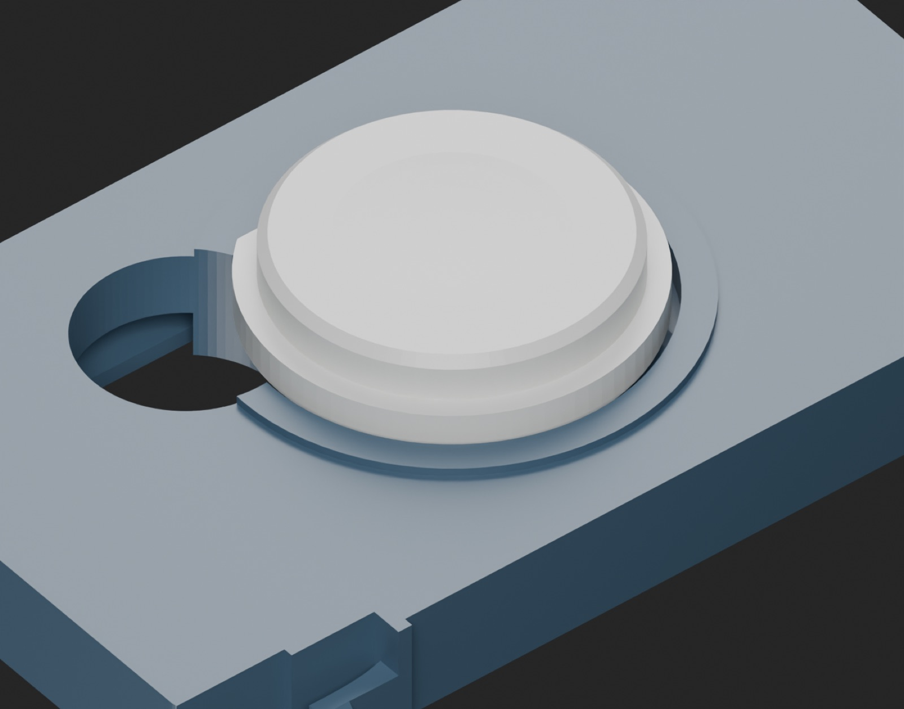
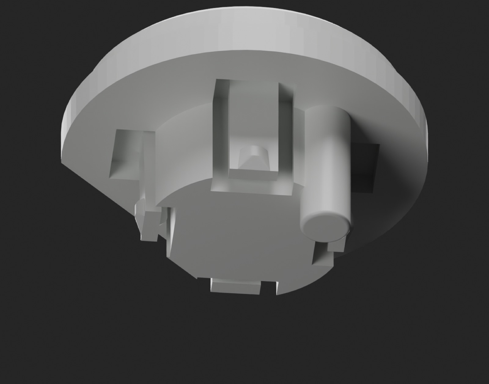

# Keyra enclosure

A printable case for the **VCC-GND YD-ESP32-S3** board (the dual USB-C DevKitC-1 clone): five printed parts,
a large mechanical button that presses the board's own BOOT switch, a light ring that carries the RGB LED's
glow around the button, and the Contour debossed in the lid. No screws, no extra electronics.

  
  

Designed by the project owner (revision "Keyra Refined", 2026-10-15). It is **not** for Espressif's own
ESP32-S3-DevKitC-1, whose buttons sit beside Micro-USB connectors: check your board against
[Measurements.md](Measurements.md) before printing.

## Two versions

| | Cable | Dongle |
|---|---|---|
| Use | A USB-C cable to the computer | A USB-C male-to-male coupler inside, so Keyra plugs straight into the port |
| Print project | [print/01_Body_PETG.3mf](print/01_Body_PETG.3mf) | [print/03_Dongle_Body_PETG.3mf](print/03_Dongle_Body_PETG.3mf) |
| STL | export from `Keyra.scad` with `dongle=false` | [stl/dongle/](stl/dongle) |
| Status | Owner-printed: board fit, USB opening, button and light ring confirmed on the previous revision; this revision's closure and button carrier reported working | The coupler envelope (27.6 × 10.7 × 6.0 mm) is an example: no real coupler has been bought or fitted yet |

The light ring is shared by both: [print/02_Light_Ring_PETG.3mf](print/02_Light_Ring_PETG.3mf). Print it in
clear or natural PETG.

  
  
  

## Files

| File | What it is |
|---|---|
| [Keyra.scad](Keyra.scad) | The parametric source (OpenSCAD). Every important value is named at the top: clearances, button travel, rest gap, logo depth. |
| [Measurements.md](Measurements.md) | Every board dimension used, with its source and confidence. |
| [Assembly_Guide.pdf](Assembly_Guide.pdf) | Illustrated assembly guide (Arabic). |
| [print/](print) | Slicer project files (3MF) with the print settings applied. |
| [stl/dongle/](stl/dongle) | Base, Top (lid), Mechanism (carrier/frame), Button, Light_Ring, oriented flat for printing. |
| [previews/](previews) | Renders. |
| [status.json](status.json) | What was checked and what is still open. |
| [Keyra_Contour.svg](Keyra_Contour.svg) | The logo path used for the deboss (docs/brand/BRAND.md §2). |

Export any part: `openscad -o Base.stl -D 'part="base"' -D 'dongle=false' Keyra.scad`
(parts: `base`, `lid`, `guide`, `button`, `light_ring`, `logo_colour`).

## The button

- At rest the plunger stays **0.70 mm** above BOOT, so the case never holds the switch down (a held BOOT at
  power-up would start the board in download mode).
- Full travel 0.90 mm: 0.20 mm of switch travel, then a hard stop, so a strong press cannot crush the switch.
- Four flexible feet hold the button on its moving carrier; return arms bring it back. RST is covered.

## Printing

Tested settings for a 0.4 mm nozzle: PETG, 0.10 mm layers (0.20 mm first layer), 5 walls, 100 % infill, no
supports; nozzle 245 °C first layer then 240 °C, bed 65 °C, flow 0.98, volumetric limit 8 mm³/s. These are
starting values for an uncalibrated filament. All STLs are already oriented flat; do not rescale them.

## Assembly

Unplug USB. Snap the button into its carrier, holding the carrier's frame, not its flexible arms. Lay the lid
face-down on a clean cloth, insert the light ring (its light-collecting cylinder towards the LED), then the
button and carrier (arrow towards USB), then the board components-down with the antenna to the back, then
the base. Press near the four clips. For the dongle, fit the coupler into the native USB port before closing.
The PDF shows every step.

After the first print: 20 presses (centre and edges) with full return; plug in USB without touching the
button and confirm Keyra starts normally; check the light shows through the ring and the logo is debossed
0.5 mm.

## Limits, honestly

Digital geometry, toolpath and component checks passed with the tolerances recorded in `status.json`. PETG
friction, shrinkage, the real switch height and long-term fatigue are not calibrated, and no endurance test has
been done. The slicer still shows one non-critical floating-region warning on the lid.

## Credits

Board outline and connector origins from VCC-GND's own files ([vcc-gnd/YD-ESP32-S3](https://github.com/vcc-gnd/YD-ESP32-S3));
component envelopes from the community model by David Scambell, assembled by Alexander Kuznetsov
([shkuznetsov/YD-ESP32-S3](https://github.com/shkuznetsov/YD-ESP32-S3), MIT). Those reference files are not
redistributed here. The enclosure design is MIT licensed like the rest of Keyra.

---

## بالعربي

علبة قابلة للطباعة للوحة **YD-ESP32-S3** (النسخة ذات منفذي USB-C)، من خمس قطع: قاعدة، وغطاء محفور عليه شعار الدرع،
وزر كبير ميكانيكي يضغط زر BOOT في اللوحة نفسها، وحامل متحرك للزر، وحلقة شفافة تنقل ضوء اللوحة حول الزر. بلا براغي
وبلا إلكترونيات إضافية. تصميم صاحب المشروع.

- **نسخة الكابل:** طُبعت وجُرّبت: مقاس اللوحة وفتحة USB والزر والحلقة.
- **نسخة الدونغل:** فيها محوّل USB-C ذكر إلى ذكر بالداخل. أبعاد المحوّل مثال، ولم يُجرَّب محوّل حقيقي بعد.
- **الزر:** يبقى بعيداً عن BOOT بـ 0.70 مم وهو مرتاح، ومشواره الكامل 0.90 مم ثم مصدّ يحمي المفتاح.
- **الطباعة:** PETG، طبقات 0.10 مم، 5 جدران، تعبئة 100٪، بلا دعامات. الإعدادات كاملة أعلاه.
- **التركيب:** الخطوات المصوّرة في [Assembly_Guide.pdf](Assembly_Guide.pdf).

