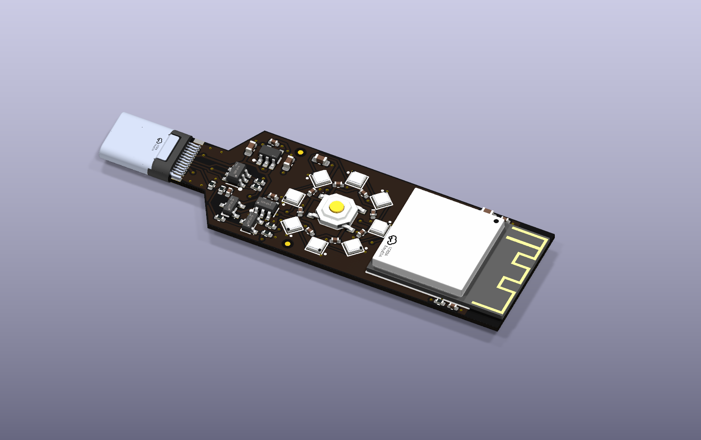
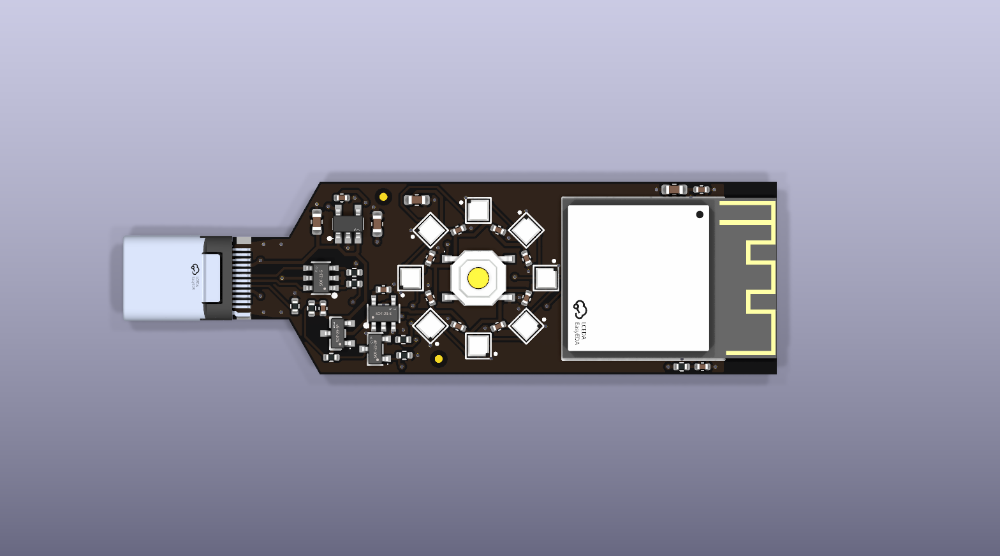
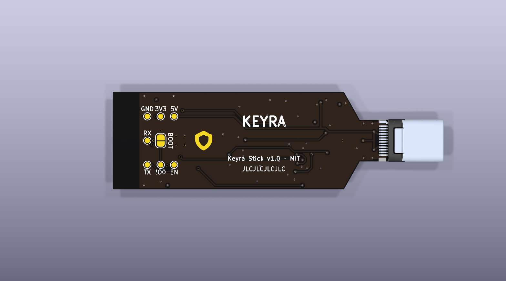

# Keyra Stick

Keyra's own board: a 0.8 mm USB-C stick that plugs straight into a computer. One big button, a
ring of eight RGB LEDs around it, the ESP32-S3 module at the far end. Open hardware (MIT), ready to
order fully assembled from JLCPCB with the files in [fab/](fab).

**The illustrated guide** walks through every part, the size, how it works, the schematic, the parts
list, ordering and first power-up: [English](docs/keyra-stick-guide-en.pdf) ·
[العربية](docs/keyra-stick-guide-ar.pdf) (PDF).

  

  
  

> **Status: designed and checked, not yet built.** The schematic passes KiCad's electrical rules
> check, the board passes the design rules check with zero errors and matches the schematic
> exactly, and every fab file is rebuilt from one description by `gen/build.sh`. No board has been
> manufactured or powered yet: if you build one, please report how it went.

## At a glance

| | |
|---|---|
| Size | 53.1 × 18.5 mm board plus the USB-C plug; about 3.2 mm thick with parts (the 2.4 mm module on a 0.8 mm board) |
| Board | 4 layers, 0.8 mm, ENIG, black mask, white silkscreen |
| Layers | top: parts and signals · In1: solid ground · In2: 3.3 V · bottom: signals and ground |
| Module | ESP32-S3-MINI-1-N8 (8 MB flash, no PSRAM); its PCB antenna at the board end with no copper under it on any layer |
| USB | USB-C plug, USB 2.0 full speed on the ESP32-S3's own USB; 5.1 kΩ Rd on CC; USBLC6-2SC6 ESD protection |
| Power | AP2112K-3.3 (600 mA) for the module; the LED ring on 5 V through a load switch on GPIO7 |
| Button | 5.1 mm tactile switch on GPIO5 (the chip's own pull-up): never a boot pin |
| Light | 8 × SK6805-EC20 (WS2812 protocol) on GPIO6 through an SN74LV1T125, for a clean 5 V data swing |
| Recovery | BOOT jumper (two pads) on the back: short it while plugging in for USB download mode |
| Firmware | the `keyra-stick` board profile: releases ship `keyra-firmware-keyra-stick.bin` |

Parts cost about US$6.7 per board at single-piece LCSC prices (November 2026: module 4.75, eight
LEDs 0.88, everything else under 1). JLCPCB adds the board, assembly, and a one-off loading fee per
"extended" part type; its quote gives the real total.

## Ordering from JLCPCB

1. Open [jlcpcb.com](https://jlcpcb.com) → **Order now** → **Add gerber file** →
   `fab/keyra-stick-gerbers.zip`.
2. PCB options:
   - **Layers: 4**, **PCB thickness: 0.8 mm**: the USB-C plug clamps a 0.8 mm board, nothing
     else fits.
   - **Surface finish: ENIG**: flat pads for the 0.5 mm-pitch plug and the 2 × 2 mm LEDs, and the
     gold mark on the back.
   - **PCB colour: black**, silkscreen white (any colour works).
   - Impedance control: not needed (USB full speed over a few centimetres).
   - **Mark on PCB / order number: "Specify a location"**, so it lands on `JLCJLCJLCJLC` on the back.
3. Turn on **PCB Assembly**: **Standard** (the plug is a "Standard only" part), **Top side**. Add
   a remark: *"J1 straddles the 0.8 mm edge: please solder its bottom-row pads too if possible.
   Edge rails on the long sides only, nothing at the USB-C end (the plug overhangs it)."*
4. Upload `fab/bom.csv` as the BOM and `fab/cpl.csv` as the placement file. Every line should
   match an LCSC part in stock; if a part is out of stock, the BOM's LCSC number names the exact
   part to substitute.
5. In the placement preview check the plug's pins sit on the pads at the tip, the module's pin-1
   dot is at its corner nearest the antenna end, and the eight LEDs all turn the same way round the ring.
   The footprints come from LCSC's own data, so nothing should need rotating.
6. Order.

The plug straddles the board. Its top row carries everything USB 2.0 needs; the bottom row only
repeats VBUS and ground, so the stick works even if that row is left unsoldered (it adds strength).

## First power-up

1. Look at the plug under a light: no solder bridges between its pins.
2. Short the BOOT jumper on the back (tweezers across its two pads), plug the stick in, then let go.
   The ESP32-S3's USB download port appears.
3. Install Keyra from the [browser installer](https://hasanalaaa.github.io/keyra/), choosing
   **Keyra Stick**, or with `esptool` and the files of a release (offsets in its
   `flash-offsets.txt`; the app image is `keyra-firmware-keyra-stick.bin`).
4. Unplug and plug in again: the ring breathes amber (setup). Continue with Keyra's normal setup.
   Later updates arrive over the air like on any other board.

Test points on the back, for bring-up or a pogo-pin jig: `5V`, `3V3`, `GND`, `EN` (short to
ground: reset), `IO0`, and the UART console `TX`/`RX` (115200 baud).

## Files

| Path | What it is |
|---|---|
| `keyra-stick.kicad_pro`, `.kicad_sch`, `.kicad_pcb`, `.kicad_dru` | KiCad 10 project: schematic, routed board, design rules |
| `fab/keyra-stick-gerbers.zip` | Gerbers (all four copper layers) and drill files |
| `fab/bom.csv`, `fab/cpl.csv` | JLCPCB's bill of materials and placement file |
| `docs/keyra-stick-guide-en.pdf`, `-ar.pdf` | The illustrated guide, in English and Arabic |
| `fab/keyra-stick-schematic.pdf` | The schematic, readable without KiCad |
| `fab/keyra-stick.stpZ` | 3D model of the assembled board (compressed STEP; KiCad and FreeCAD open it), for enclosures |
| `renders/` | Top, back and angled renders |
| `lib/` | Footprints and 3D models of the LCSC parts (from LCSC/EasyEDA data); their schematic symbols, drawn by `gen/symbols.py` |
| `gen/` | The generator: `design.py` holds every part, net and position; everything else is built from it, the guide included (`make_guide.py`, words in `guide_text.py`) |

## Changing the board

Edit `gen/design.py`, then run `gen/build.sh`. It draws the schematic, places the board (nets from
the schematic's own netlist), drops a via from every ground and 3.3 V pad into its plane, routes the
rest with Freerouting, fills the planes, runs the electrical check and the design rules check with
board-to-schematic parity, and writes every fab file and render. It needs KiCad 10, Java 21 and
Freerouting 2.1: `FREEROUTING=/path/to/freerouting-2.1.0.jar gen/build.sh`. After editing the board
by hand in KiCad, `gen/build.sh fab` re-checks it and re-exports the fab files only. Both end by
printing the guide with Google Chrome (`CHROME` overrides its path).

## Design notes

- **Antenna.** The module's antenna is flush with the board end and nothing is under it on any
  layer (Espressif's PCB layout guide). Keep metal away from that end in an enclosure.
- **Thin.** The plug sets the board at 0.8 mm (SHOU HAN DWG001-A401, "Cable Side PCB Layout"), and
  the tongue follows that drawing: 6.10 mm wide for 0.90 mm at the tip, then 7.90 mm to 6.30 mm.
- **USB.** Full speed (12 Mbit/s) edges take about 4 ns; traces of a few centimetres are far below
  the length where the pair's impedance matters, so they are routed short rather than as an
  impedance-controlled pair. The top layer sits on the solid ground plane.
- **Inrush.** At plug-in VBUS sees about 5 µF directly (USB 2.0 allows 10 µF), plus the 3.3 V
  rail's capacitors charged through the LDO's current limit. The ring's 5.5 µF waits behind its
  switch, which turns on over about a millisecond once the firmware drives GPIO7.
- **Heat.** The LDO drops 1.7 V: about 0.2 W at Keyra's typical 120 mA, more during Wi-Fi bursts,
  spread into the planes.
- **Beside the module.** The 18.5 mm width leaves a strip on each side of the module: its EN
  reset RC sits right at pin 45 and 4.7 µF + 100 nF right at its 3V3 pin, as Espressif asks.
- **Boot.** GPIO0 keeps the chip's own pull-up (normal boot); only the BOOT jumper selects
  download mode, so the main button can never start the board in the wrong mode.

---

## بالعربي

**Keyra Stick** هي لوحة Keyra الخاصة: عصا رفيعة بسمك 0.8 ملم تنشك مباشرة بمنفذ USB-C بالكمبيوتر.
بيها زر كبير بالنص وحوله حلقة من 8 أضواء ملونة، والرقاقة بنهاية العصا. التصميم مفتوح المصدر،
وجاهز ينطلب مركّب بالكامل من مصنع JLCPCB بملفات مجلد [fab](fab).

**الدليل المصوّر** يشرح كل قطعة، والمقاس، وطريقة العمل، والمخطط، وقائمة القطع، وطريقة الطلب، وأول تشغيل:
[بالعربي](docs/keyra-stick-guide-ar.pdf) · [English](docs/keyra-stick-guide-en.pdf).

**الحالة:** التصميم مكتمل ومفحوص: المخطط نجح بالفحص الكهربائي، واللوحة نجحت بفحص قواعد التصنيع بدون
أي خطأ وتطابق المخطط تماماً. بس بعد ما انصنعت ولا جُرّبت أي لوحة.

**طريقة الطلب:**
1. ادخل على موقع jlcpcb.com، وارفع ملف التصنيع `fab/keyra-stick-gerbers.zip`.
2. اختار: **4 طبقات**، و**سمك 0.8 ملم** (لازم، لأن رأس الـ USB-C ما يركب على غيره)، وتشطيب **ENIG**، واللون أسود.
3. شغّل **التجميع** (PCB Assembly): نوع **Standard**، والوجه العلوي.
4. ارفع `fab/bom.csv` (قائمة القطع) و`fab/cpl.csv` (أماكن القطع)، وتأكد كل القطع موجودة بالمخزن.
5. بالمعاينة تأكد: أرجل الرأس على وساداتها، ونقطة الرقاقة بالزاوية القريبة من نهاية الهوائي، والأضواء كلها بنفس الاتجاه.
6. اطلب.

**بعد ما توصلك:** وصّل نقطتي BOOT اللي ورا اللوحة بملقط وانت تشكها بالكمبيوتر، وثبّت Keyra من موقع المشروع
واختار **Keyra Stick**. بعدها كل التحديثات توصل عادي من «الجهاز ← تحديث البرنامج».

